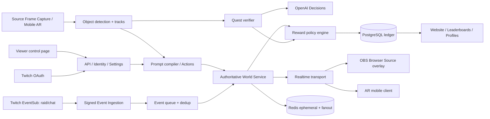

# ARCHITECTURE — production services and streaming data flow

## High-level map

## Services
- `apps/web`: Next.js SEO/SSR public website + dashboards, authenticated Twitch account management, leaderboard and social sharing, player profile/controller; server components fetch cached public API snapshots.
- `apps/overlay`: Vite transparent canvas WebGL overlay with WebSocket auth by creator-scope signed short-lived overlay tokens; renderer consumes world snapshots, interpolates at 30/60fps, runs portal cinematic and plays original sounds without exposing private tokens. OBS browser source URL is revocable. Support aspect ratios 16:9 and vertical 9:16, source crop UI, transparent pass-through.
- `apps/api`: Fastify/NestJS HTTP with Twitch OAuth, authenticated viewer commands, creator/admin settings, public leaderboard endpoints and status; separates guest/share pages from privileged modifications.
- `apps/event-ingestor`: Webhook/Conduits (at scale) or WebSocket for local experimentation; handle Twitch duplicate delivery, signature and timestamp/replay checks, per-channel subscription reconciliation, retries/revocation; enqueue and ACK promptly.
- `apps/world`: durable WebSocket authoritative state, per-stream rooms, multiplayer avatar state, nav/physics collision, sequenced actions, raid orchestration, region transforms, deterministic quest checks, resource caps. No LLM secret in client.
- `apps/worker`: prompt queue, quest verification, event outbox fanout, image processing; cost budgets, circuit breakers and dead-letter handling.
- `services/vision`: opt-in source-frame ingest and tracking; support plugin providers (local MediaPipe/ONNX, GPU SAM2 on server, custom trained), scene world-graph outputs. Frame timestamps synchronized with overlay positions.
- `apps/mobile`: Unity AR Foundation application for IRL streamers. Handles camera, plane/anchor, segmentation/depth if supported, 3D render, microphone/mixer and live streaming pipeline; communicates transformed tracked target metadata and periodic sampled frames only if enabled.
- Infrastructure: PostgreSQL for durable data, Redis for current rooms/pubsub/limited TTL keys and work queues, object storage only for consented clip/evidence assets (short TTL), secrets manager, observability, CDN for assets.

## Integration concerns — exact constraints
### Twitch inbound
`channel.raid` with `condition: {"to_broadcaster_user_id":"..."}` receives from/to creator IDs and count; no viewer roster. For chat use `channel.chat.message` and inspect `chatter_user_id`, `message_id`, channel ID. Cloud bot auth model differs from single-user installed token. Consult docs each time and request minimal scopes. Server production webhook requires verified HMAC and callback TLS; process quick ACK; persist event ID for idempotency. Subscription limits and conduit management matter for many creators. Use actual Twitch CLI test harness.

### OBS and camera source geometry
A simple Browser Source overlay has no direct access to frames from the broadcaster's other OBS sources. Explicitly implement one of: (1) OBS plugin/companion that captures permitted source frames and source transform; (2) streamer broadcasts camera through first-party browser/mobile capture with permission; (3) OBS WebSocket-controlled source routing plus authorized companion frame tap. Never assume Browser Source can secretly read OBS's webcam. Get source dimensions, canvas output dimensions, crop, scale and mirror so bbox is mapped correctly. Alignment UI should visually confirm tracked target at a test marker. Vision remains optional, and overlays/raids work without it.

### Audio and output
OBS overlays usually route audio through browser source according to OBS settings; test and instruct streamer on audio setup. Web Audio often starts muted until user gesture; implement audio prearm workflow / OBS settings and robust fallback. Avoid sudden volume spikes. Duck portal audio against music, support mute, volume control, reduced motion, epilepsy/accessibility settings.

### IRL streaming
Phone captures -> local AR tracking and rendering -> composite audio/video -> Twitch-compatible output (RTMP/RTMPS or supported capture/relay). LiveKit is optional for inter-device remote ingest or cloud relaying; not inherently required to render a portal. ARCore/ARKit features vary by device: capability detection and fallback mandatory. Camera AR app must put composed frames on actual stream, not just a private preview. Support orientation changes, network drops, thermal throttling and low power. More demanding video segmentation can be server-side if latency and privacy budgets allow, with feature toggles.

### Time and latency
Twitch viewers experience broadcast delay, so input must be anchored to the latest source frame time and action is visible after broadcast latency. Viewer web controller needs UX for round-trip acknowledgement; avoid precise reaction mini-games requiring <100ms chat latency. Time-stamp each room event `{serverTime, tick, sceneEpoch, sourceFrameTime}`. Invalidate tracked target IDs when scene/epoch changes. Each overlay sim interpolates authoritative snapshots and handles reconnect by asking for fresh snapshot, not replaying old raid cinematics.

## Realtime action lifecycle
1. Chat EventSub message arrives (unique Twitch ID, channel ID, chatter ID, text). Authenticate source/authorization, deduplicate, rate-limit and store minimal command record.
2. `!rift ...` queue yields action ID; emit `action.accepted`. Server compiles deterministic commands instantly; natural language via AI worker and strict schema validation.
3. World service resolves actor and target from synchronized scene graph. If user isn't in room, join/spawn by verified Twitch ID. If target absent, send `action.failed` with friendly explanation.
4. Run character ability/cost/creator permissions gates and load snapshots; schedule bounded sequence at authoritative ticks, emit `action.started`, `action.step`, `action.completed`, `action.failed` with reason.
5. Renderer local interpolates navmesh/trajectory and plays the same cues at scheduled stream-time. Phone AR client uses local pose and coordinates for anchor attachment while server remains source of game logic.

## Capacity patterns
- Interest management and spatial/render density budgets; 10k raid viewers should not instantiate 10k high-poly characters at 60fps. World maintains accurately identifiable active players and anonymous count; render the remaining raid as crowd particles/instanced silhouettes. Spread entry animation across time.
- Cache clips and model asset manifests on CDN. Avoid per-frame DB writes; periodically snapshot positions for recently active avatars, retain no needlessly sensitive location/scene data.
- Shard world rooms by channel ID; one server process can host multiple rooms, consistent dispatch with Redis; durable events in Postgres/queue. Idempotent cross-instance fanout.
- Billing/cost visibility: model call count, GPU inference time, video bandwidth, per-creator and per-viewer rate limits, plan limits, latency, fallback health; admin can disable expensive AI categories.

## Failures and recovery
- EventSub expired token: refresh, reconcile subscriptions; show degraded status, retain offline simulator.
- Twitch duplicate webhook / reconnect: exactly-once *effects* via DB unique external IDs, even if at-least-once delivery.
- World server restart: restore room stable state and most recent snapshot; reset temporary actor animations gracefully. Reconnect overlays with fresh world epoch; don't replay completed historical raids.
- Vision dropout/occlusion: stale target TTL, stop/reanchor safely, visually communicate lost target.
- Model timeout: deterministic fallback or queue expiration, no phantom actions.
- Reward transaction failure: replay idempotent award in DB transaction; never award twice.
- Overlay blocked audio/WebGL unavailable: turn down features and degrade to performant 2D renderer.
