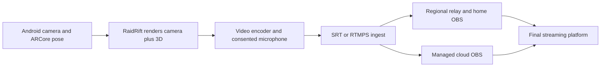

# Real IRL streamer workflows — U.S. focus

Research date: 2026-10-29. The owner requested global compatibility with particular attention to America. Exa and Firecrawl were used to inspect provider instructions, project documentation and a named U.S. production. These establish actual supported workflows, not a statistically measured market-share ranking. Provider endorsements do not prove every named creator always uses the same equipment.

## What streamers actually connect

| Workflow | Field software/equipment | Receiving software | Evidence |
| --- | --- | --- | --- |
| Android phone with managed production | IRL Pro; SRT/SRTLA uplink | IRLToolkit cloud OBS | IRLToolkit's current quick-start explicitly recommends IRL Pro for Android and supplies an app configuration link. |
| iPhone equivalent | Moblin; SRT/SRTLA uplink | Relay plus home OBS, or managed cloud OBS | IRLToolkit documents Moblin setup; Moblin's own project documents bonding and OBS remote controls. |
| Phone/encoder with home computer | IRL Pro, Moblin or compatible SRT encoder | SRT relay → OBS Media Source; NOALBS scene switching | IRLServer's OBS/Android guides and NOALBS describe this complete chain. |
| Production backpack | Camera → LiveU Solo PRO/LRT | SRT relay → OBS/vMix, or IRLToolkit | UnlimitedIRL publishes both workflows and a desktop/IRL switching procedure. |
| Named major U.S. production | IShowSpeed's 2025 America tour: TVU RPS One, cellular/Starlink | TVU Producer cloud switching and production | TVU and UnlimitedIRL document the deployment; this specific tour must not be described as merely phone → home OBS. |

The short answer to “is there a relay and OBS?” is **yes, in documented mainstream service workflows**. Some creators use cloud OBS; larger productions may use a different cloud mixer entirely. An ordinary relay transports the feed; cloud OBS also performs composition/transcoding/scenes. These are distinct services.

### Android and managed OBS

[IRLToolkit's quick-start](https://kb.irltoolkit.com/cloudobs/0-QuickStart) identifies IRL Pro for Android, Moblin for iPhone and LiveU Solo Pro as recommended encoders. It accepts RTMP/RTMPS/SRT/SRTLA and recommends avoiding RTMP on lossy field connections when another supported protocol is available. Its ingest scene system handles offline/low-bitrate conditions.

[IRL Pro's own page](https://irlpro.app/) confirms RTMP/SRT destinations, SRTLA multi-connection bonding and adaptive bitrate. That page lists OBS WebSocket control under **TODO**, so search snippets advertising it are not sufficient proof it currently works. Its public page does **not** establish a supported API for receiving our Filament surface, nor verified screen capture of a different AR app. Do not promise that users can simply “turn on RaidRift inside IRL Pro.” A guessed GitHub repository returned 404 and was discarded.

[Moblin's own project](https://github.com/eerimoq/moblin) documents OBS remote control, screen capture, bonding, bitrate adaptation and scene fallback. Those iOS capabilities do not automatically exist in IRL Pro or our Android client. Its camera/background restrictions also matter: another app's screen-source support alone does not prove simultaneous tracked AR capture.

### Relay into the streamer's existing OBS

[IRLServer's OBS guide](https://irlserver.com/guides/obs-setup) describes phone/encoder → regional relay → home OBS → Twitch/Kick. OBS receives the relay as a network Media Source. Its [IRL Pro guide](https://irlserver.com/guides/connect-irl-pro) describes Android SRTLA bonding and connection details. [NOALBS](https://github.com/NOALBS/nginx-obs-automatic-low-bitrate-switching) monitors ingest conditions and switches OBS to suitable scenes through OBS WebSocket. A relay by itself does not guarantee that the final channel stays live: the receiving broadcaster and its fallback scene must continue running.

[OBS's SRT guide](https://obsproject.com/kb/srt-protocol-streaming-guide) documents SRT caller/listener/rendezvous modes and URL options. Follow each provider's exact stream ID and latency units; do not reuse one vendor's port or URL syntax for another. Select a U.S. region near the broadcaster for a U.S. trial, then measure delay/loss; geographical proximity is a starting assumption, not a measured latency result.

### U.S. production evidence

[UnlimitedIRL's LiveU guide](https://support.unlimitedirl.com/getting-started/setting-up-your-liveu-solo-pro) documents direct-to-platform, SRT-to-relay/home-OBS and SRT-to-IRLToolkit alternatives. Its [IRLToolkit setup](https://support.unlimitedirl.com/getting-started/irltoolkit-configuration) shows how a phone browser controls remote OBS; a separate desktop ingest permits switching without ending the public broadcast.

For a specific American production, [TVU's September 2025 IShowSpeed case study](https://www.tvunetworks.com/story/ishowspeed-35-days-cross-country-livestream-technology/) and [UnlimitedIRL's TVU page](https://unlimitedirl.com/products/tvu) describe RPS One backpacks and TVU Producer for the U.S. tour. Treat this as a documented production-specific deployment, not a universal current setup for that creator. General celebrity gear lists are weaker evidence than this named deployment.

## Where RaidRift fits

**The intended Android trial must publish the already-composited AR image.** Adding an ordinary browser overlay downstream of a backpack camera cannot supply that camera's missing ARCore pose, anchors or calibrated environmental depth. With a separate camera/backpack, the AR view can be an additional source or camera-angle switch; it must not pretend to be tracked through the separate camera. The desktop video-overlay mode remains a separate capability.

The native client now implements direct SRT/RTMPS/RTMP publishing of the Filament surface, optional consented microphone AAC, manual bitrate controls, bounded retry/status and lifecycle shutdown. Experimental direct-LAN WebRTC and silent local MP4 remain available. The mobile broadcast acceptance gate additionally requires measured low delay, recovery, receiving-OBS failover and a sustained physical cellular trial. Plain SRT is not SRTLA bonding. No new paid provider account is needed for a private local rehearsal.

[RootEncoder](https://github.com/pedroSG94/RootEncoder), Apache-2.0, version 2.8.1 is integrated with full upstream notices. The actual encoded native output has passed private SRT stream-ID publishing to MediaMTX 1.21.3, followed by RTMP decoding and recording in OBS 33.0.0. This used a Boat Android emulator and a camera-off 3D scene. AAC contains an injected emulator microphone signal. RTMPS TLS, encrypted SRT, commercial provider authentication, physical microphone quality and tracked AR video remain separate unpassed tests. Manual bitrate is implemented; automatic adaptation and SRTLA bonding are not.

## Streamer acceptance runbook

1. **Private local rehearsal:** ARCore-capable Android phone → RaidRift → local SRT/RTMP receiver → OBS recording. Verify that moving around a desk changes the model perspective, feet remain anchored, the same server actors receive their own actions, the encoded output contains both camera and characters, and controls/tokens are absent from the broadcast surface. No public stream is needed.
2. **Audio and lifecycle:** with explicit consent, verify actual decoded microphone audio and A/V sync; test denied permission, mute, stop, tracking loss, pause/revoke, screen lock, backgrounding and receiver disconnect. A silent clip or browser synthetic frames cannot pass this gate.
3. **Existing U.S. relay:** the streamer supplies their existing ingest privately, selects a nearby U.S. region and adds its watch URL as an OBS Media Source, or selects a separate input in managed cloud OBS. Start with a conservative 720p30 H.264/AAC profile; record measured rather than promised delay, bitrate and dropped frames.
4. **Field failure:** walk between Wi-Fi and cellular, interrupt connectivity and restore it. Observe the receiving OBS recording and its LIVE/LOW/BRB transitions. Confirm the final broadcaster stays connected independently of the field feed, that recovery does not duplicate actors, and that stale camera/character frames do not linger after an explicit stop.
5. **Sustained phone test:** run at least 30 minutes and record device/OS/GPU, thermal throttling, battery drain, anchor drift and usable frame rate. An emulated room cannot establish these properties.
6. **Public trial only after private pass and creator authorization:** preserve the creator's existing broadcast workflow, scene collection and fallback. Record exact app/relay/OBS versions and test artifacts. Avoid purchasing services or publishing real footage merely to prove compatibility.

Current verdict: **private native → SRT → relay → custom WHEP OBS Browser Source demonstrated, including an action-to-decoded-frame upper bound of 1.948 seconds.** Earlier RTMP Media Source measurements of roughly 6–9 seconds remain historical failures. The stock MediaMTX browser player retained a stale image on disconnect; the custom `/relay-receiver` monitors decoded video frames and detaches frozen video even if audio/ICE remain live. Actual authoritative pause cleared OBS content within 4.579 seconds; synthetic browser freeze coverage passes separately. Native H.264 is copied through the bridge, while AAC is converted to Opus for WebRTC. The current lab configuration has private loopback listeners and no provider credentials. These results cover camera-off actual 3D, not tracked AR, physical audio quality, cellular operation, Twitch/Kick delivery or a public broadcast. See `artifacts/android-runtime-qa.json`. Physical field and AR placement acceptance remain open.
