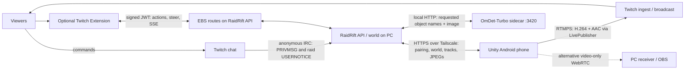

# RaidRift MR: phone-to-Twitch guide

Source review: **October 31, 2026**, branch `fix/android-ar-recovery`. The live Unity project is **`E:\RaidRift-MR`**; `apps/unity-ar` is a repository copy and can lag behind it. This guide describes the live source, not the older Kotlin Android client or the original product brief.

RaidRift puts a small fantasy party into the streamer's camera view. The phone scans real surfaces, opens a voxel rift and animates individual viewer heroes. Viewers join and direct their own hero through Twitch chat; an optional Twitch Extension adds buttons, target selection and held movement. The phone can broadcast the camera, heroes, effects, microphone and game audio directly to Twitch.

Start with the [three-minute street checklist](STREET_TEST_RUNBOOK.md). For recording, use the [2:45 video script](DEMO_VIDEO_SCRIPT.md). For Extension registration and hosting, use [the owner checklist](TWITCH_EXTENSION.md).

## What is verified

| Area | Evidence and current boundary |
|---|---|
| Unity version | `Editor/BuildTools.cs`: **0.20.0**, package `world.raidrift.mr`. `RaidRift-MR-0.20.0.apk` was built and published to the private APK share on October 31 at 22:23 Kyiv after `RoomSelfTest` and `CameraFeelSelfTest` passed and HUD previews rendered. Later overnight builds are listed in the Unity lead's log; the newest known-good APK is named on the owner's dashboard page. No build has a phone pass yet. |
| 0.20 contents | Selfie mode, three scan views (Mesh / Floor / Hidden), no per-pixel depth occlusion, floor smoothing, stronger CameraFeel, bigger Cartoon FX/emote bursts and world-space name tags, regrouped settings with Phosphor Fill icons. Selfie is untested on the device. |
| Backend / Extension | Historical receipt: [extension-verification.json](../artifacts/extension-verification.json): 91 Node passes, one conditional PostgreSQL skip; four Extension browser passes per build. Tests use fixture authorization and a local EBS. |
| Twitch input | Same receipt records an actual anonymous IRC acknowledgement from `#twitch`. It does not prove viewer commands, an incoming raid or a complete phone broadcast. |
| Publisher | Live plugin records standalone C# core, Android build, three JVM tests and smoke-APK checks. Its original Unity GPU/full-app verification was blocked by temp-directory permissions. Later APK files do not prove those checks ran for today's source. |
| Phone acceptance | Historical owner recordings informed floor/occlusion fixes. Current complete AR + detector + selfie + Twitch A/V + walking/thermal loop remains **untested on device in the reviewed evidence**. No tests or builds were rerun during this documentation-only review. |

Older status notes in the Unity README, `MOBILE.md`, `CURRENT_STATE.md` and early progress entries describe earlier builds. Use this guide for the current Unity workflow; use [ACCEPTANCE.md](ACCEPTANCE.md) for the broader product release gates.

## Architecture and authority



The PC handles accounts, input ownership, bounded plans, world snapshots and deterministic accounting. Unity owns local AR geometry, NavMesh paths, animation and final rendering. Local physical positions are not authoritative reward evidence. The private tailnet harness uses an in-memory database: its accounts, scores, pairing and world disappear on restart. Persistent accounts and Shards exist in the normal database-backed API, not as a persistence guarantee for this rehearsal server.

**Two independent connections:** phone → Twitch sends video/audio over the phone's internet connection. Phone ↔ PC over Tailscale carries game state and chat results. A LIVE publisher chip does not prove chat is connected. Twitch video delay also means controls are not instantaneous feedback.

### Phone/server contract

| Route | Use |
|---|---|
| `GET /v1/debug/pair` | Private debug harness only: obtains a capture token. Production uses a Creator Studio mobile token. |
| `GET /v1/native/world` | Bearer-authenticated snapshot; the client waits about 150 ms after a successful reply before polling again. At most 12 heroes are imported. |
| `POST /v1/native/tracks` | Up to 50 phone targets, about every 0.4 s; server timestamps receipt. |
| `POST /v1/native/frame` | One downscaled displayed-camera JPEG about every 1.5 s while paired, landed and tracking; vision consent is checked on the server. |
| `POST /v1/live/channel`, `GET /v1/live/status`, `DELETE /v1/live/channel` | Select, inspect and stop the real Twitch IRC reader for the paired room. |
| `POST /v1/native/chat` | Simulator input only. Live returns `VIEWER_CONTROLLER_REQUIRED`; the phone cannot impersonate a live viewer. |
| `POST /v1/native/debug/event` | Private owner test events, including test raids. |
| WS `/v1/media` | Alternative WebRTC signaling, not the direct Twitch publisher. |

`ServerConnection` saves server/token locally. HTTP 401/403 during world polling clears pairing; transport failures retry after 1.2 s and retain the last snapshot. This is not a guaranteed global freeze on network loss. The Twitch chat reader runs on the PC, so a phone network switch (Wi-Fi ↔ mobile data) does not interrupt chat input; the phone simply resumes polling once the tailnet is reachable again. Source after 0.20.0 also re-pairs automatically after a server restart (debug pairing only) and re-selects the Live channel whenever the world snapshot does not show it; selecting the channel that is already connected is a no-op on the server, so these retries never drop the reader.

The IRC reader is read-only: `justinfan` login, tags/commands capability negotiation, message-ID deduplication, numeric user IDs, PING/PONG, a client PING after 45 s of silence (Twitch itself only PINGs about every 5 minutes, so quiet channels used to trip the watchdog), a 90 s heartbeat watchdog and capped reconnect. Real raids use `USERNOTICE msg-id=raid`. A raid supplies a count and source, **not the names of all arrivals**. Named heroes come from participants; debug names are fixtures. The separate OAuth/EventSub adapter still exists in `apps/api/twitch.ts`; the private harness clears OAuth credentials. Do not ingest the same channel's raids through both paths.

### Optional Extension

`apps/twitch-extension` supplies overlay, component, panel and mobile HTML surfaces. The EBS in `apps/api/extension.ts` verifies HS256 Twitch JWTs, expiry, role and channel; it exposes server actions, held steering and SSE state. Opaque identities are separate from numeric Twitch identities until sharing/linking. Opaque accounts cannot receive join/quest Shards.

The normal review build disables keyboard shortcuts; focused WASD/arrows are private Local Test only. D-pad buttons remain available. **Registration requires the owner's Twitch Console login, Extension Client ID/Secret/owner ID, allowed testers and activation. Ordinary viewers also need a public HTTPS EBS; a `.ts.net` Serve address is private.** See [TWITCH_EXTENSION.md](TWITCH_EXTENSION.md) for exact settings, build commands, review and hosting steps. Never expose the debug harness wholesale to obtain an EBS.

## Scan → floor → landing

1. Use the rear camera in a well-lit area. Sweep slowly across textured floor and nearby furniture; do not stare only at a blank wall.
2. Niantic Spatial SDK **4.1.0-26051913**, using `NsdkARCoreLoader`, supplies mesh chunks through AR Foundation **6.4.2** `ARMeshManager`. This is a phone implementation inspired by the Phanto pattern, not Quest Phanto running on Android.
3. `RoomNavigation` asynchronously rebakes a doll-sized Unity NavMesh every **0.8 s**, when the previous bake finishes. The bake covers a 14 × 5 × 14 m box around the phone; chunks beyond 20 m are omitted and the Niantic extension is configured to cull old mesh beyond 25 m.
4. When mesh exists it is the walkable geometry source. Tracked horizontal ARCore plane polygons provide a weaker geometry fallback; planes also help estimate floor height. No infinite floor is added.
5. Floor estimation uses area-weighted **3 cm height bands**, ignores tiny low specks and requires three winning bakes before switching to a different band. A close plane estimate can refine the mesh estimate. Published height glides by at most 1 cm per update unless a change exceeds 15 cm. These are heuristics, not ground truth.
6. Automatic landing looks roughly 1 m ahead (or where the camera ray meets the floor), samples nearby alternatives, requires floor-height agreement within 20 cm and over 15 cm edge clearance, then holds a candidate within 25 cm for **0.8 s**. Alternatively tap measured open floor. The progress chip disappears after landing.

The NavMesh agent radius is 7 cm, height 30 cm, climb 8 cm, slope limit 40°, voxel size 4 cm. Thin obstacles, stairs, reflective floors and moving objects can be missed. Scan visualizations are diagnostic surfaces, not proof of collision precision. After landing/raid/go-live the app hides the scan overlay automatically.

**Occlusion:** hidden mesh writes depth so heroes can disappear behind scanned furniture. Per-pixel `AROcclusionManager` was removed in the 0.18.2-era source after floor flicker and clipped feet. Do not promise dynamic person/hand occlusion or a current per-pixel depth pass.

## Heroes and walking

Four KayKit Adventurers models—Knight, Mage, Rogue, Barbarian—are imported through glTFast with legacy animation clips. Models are assigned deterministically from hero ID; the phone does not implement every website cosmetic. Heroes are about **30 cm** high, use `NavMeshAgent`, smooth facing, contact shadows, footstep variants, jump arcs and landing squash/effects. Missing model imports show a capsule placeholder.

Raised walkable islands 15 cm–1 m above the floor can receive bidirectional jump links, with measured endpoints and bounded gaps. Each bake limits the top samples and links. Agents explicitly animate the link traversal; this is not arbitrary climbing or a guarantee that every chair is reachable.

Without recent input, heroes roam reachable floor and furniture tops, sometimes sit on recognized raised seats, rest and wave near the camera. Targeted commands take priority over roaming; a newer command replaces a pending pose. `ActAt` walks toward the local target before posing, checks both horizontal distance and height, and abandons a pending pose after 15 s.

**Follow me** keeps the party near the camera. If untouched, follow activates after moving about 4.5 m from the original landing. With follow active, the rift can relocate when the streamer is over 8 m away and suitable scanned floor exists ahead; it waits for entrances to finish. Distant heroes can **rift-hop** to catch up (over 6 m, or stuck while following beyond 2.5 m). Mesh recovery can also warp to nearby support. Do not describe this as never teleporting or guaranteed seamless city navigation.

## Chat and planner reference

Ask viewers to use separate messages, with at least half a second between messages; the IRC reader drops faster per-user input. Start with `!join`. Commands direct the sender's virtual hero, never the streamer, a pet or a bystander.

| Type exactly | Meaning / requirement |
|---|---|
| `!join` | Join or re-enter with that viewer's numeric Twitch identity. |
| `!w`, `!a`, `!s`, `!d` | Separate messages: away from camera, screen-left, toward camera, screen-right. `!up`, `!left`, `!down`, `!right` and `!rift w` are aliases. These are short steering pulses; **`!w!a!s!d` is not a combined command**. |
| `!jump`, `!dance`, `!wave`, `!sit`, `!stop` | Immediate bounded basics. Sit holds locally until replaced. Dance/wave/cheer share the KayKit Cheer clip in this renderer. |
| `!rift turn left`, `!rift turn right`, `!rift turn around` | Turn without asking a real person to move. |
| `walk right`, `run left`, `jump`, `wave at me`, `sit down`, `turn around then dance` | Recognized ordinary phrases for an already participating viewer. Plain `w/a/s/d` is ignored. |
| `стрибни`, `танцюй`, `помахай рукою`, `сядь`, `йди вперед`, `підійди ближче` | Supported Ukrainian phrase examples. This is a bounded phrase grammar, not universal translation. |
| `!rift go to 3 and dance` | Go to currently published **spot 3** and pose. Replace 3 with a number visible now. |
| `!go to #3`, `!jump on 3`, `!rift sit on spot 3` | Alternate numbered target forms. Missing numbers are refused. |
| `!rift sit on the sofa`, `!rift walk to the chair then wave` | Requires a published label and a locally reachable surface. Multiple matching objects can require controller selection. |
| `!rift run to the dog and sit on it` | Virtual choreography only. Detection/grounding is approximate; current phone code does not prove sitting precisely on a moving dog's silhouette. |
| `!rift go over there and dance`, `!rift come back to me`, `!rift go to the portal` | Spatial vocabulary: center-of-view `there`, floor-under-phone `streamer`, and `portal`. Flexible wording can require the configured model. |
| `!rift walk left then jump then wave` | Short sequence. Offline/plain phrase grammar accepts at most four clauses; server plans allow at most eight steps / 15 s, so expansions may reject even shorter-looking prompts. |
| `!ourapp dance` | Supported `!rift` alias. |

Synonyms come from `targets.ts` and compiler target binding: **sofa/couch/settee; table/dining table/desk; plant/potted plant; tv/television/monitor; puppy/doggy/dog; kitty/kitten/cat; seat/stool/armchair → chair/sofa; mug/cup; bike/bicycle**. Matching still requires an appropriate track; synonyms do not create detections. Some mappings are available only during model target binding, so a short exact label or number is the most predictable test.

Only recognized ordinary chat reaches actions. Free-form target requests should start with **`!`**, `!rift` or `!ourapp`; ordinary “sit on the sofa” is not recognized by the simple unprefixed phrase parser. `!` requests use a small model first when configured, except basic commands; deterministic compilation is the offline/budget/infrastructure-failure fallback. Target errors are retained as failures. Provider configuration is server-side (`AI_PROVIDER`, `PLANNER_BASE_URL`, `PLANNER_MODEL`, `PLANNER_API_KEY` / `GROQ_API_KEY`, or `OPENCODE_GO_API_KEY`). Each planner attempt is limited to `PLANNER_TIMEOUT_MS` (default 6 s); the Groq path retries once on OpenCode Go, then falls back to keywords, so a stalled provider costs at most about 12 s. Codex is the development tool, not a mandatory live chat model.

Model output is typed choreography, checked against the action/animation catalogs, fresh targets, ownership, moderation and budgets. Newer instructions invalidate late plans. No generated code executes. The web/server catalog is larger than the phone renderer: dragon riding, voxel construction, backflips and other catalog entries do **not** establish distinct working Unity behavior. Use the basics and measured target actions above for the phone demonstration.

## Perception: labels and open vocabulary

| Layer | Implemented behavior | Limits |
|---|---|---|
| On-device `ObjectDetector` | **YOLOX-S**, COCO-80; Unity Inference Engine **2.6.1**. Loads only `Resources/Models/yolox_s`, input 1×3×640×640; BGR letterbox, output 1×8400×85; score 0.3, class-wise NMS IoU 0.45. GPUCompute or CPU fallback, one inference in flight, nominal capture interval 0.5 s. | An older Tiny file/comment remains; Tiny is not the selected runtime model. No device FPS claim. Built-in rendering pipeline and async GPU readback required. |
| `SurfaceLabels` | Capture-time pose/projection lifts box rays onto measured walkable geometry. Raised furniture uses clustered top hits; other objects use floor contact. Allowlisted stream-relevant classes only. | This is geometric association, not a semantic room mesh. Moving classes expire after 4 s, other labels after 60 s; stale furniture is possible. No identity recognition. |
| `SceneTracks` | Publishes labels plus `there`, `streamer`, `portal`, up to three furniture-top tracks and roughly six numbered markers. World targets are resolved locally for hero actions. | Markers survive brief offscreen periods; numbers can change as the view changes. Follow the currently visible number, not an earlier Twitch frame. |
| PC open vocabulary | Latest phone JPEG → local **OmDet-Turbo** (`omlab/omdet-turbo-swin-tiny-hf`) at `127.0.0.1:3420`; requested nouns, best box per class, score ≥0.3, 3 s request timeout, input frame ≤5 s old. | Optional sidecar, not automatic recognition of every object. Server boxes must be lifted back onto phone geometry. No hit or stale frame yields a target error. |

`SceneTracks` copies the displayed camera background in render order with the pose for that frame, encodes a **480 px-wide** JPEG on a worker, and retains a small frame-pose map. Server detections are reprojected and re-posted for up to 20 s locally; ordinary local world targets expire after 2.5 s without refresh. Server native track hold is 4 s. These different lifetimes mean a remembered target is not necessarily visible at this instant.

The server stores only the latest JPEG per room in memory; its getter drops entries older than 60 s, and detection refuses frames older than 5 s. This is lazy expiry, not a strict timed deletion service. No disk frame archive is implemented on this path. While paired/landed/tracking, frame upload is automatic; there is no separate detector/upload toggle in this HUD. The harness starts with vision enabled. **Do not call the app camera-offline or local-only while paired.**

To start the optional detector on the PC:

```powershell
powershell -File services/ov-detector/start.ps1
```

See [sidecar setup and recorded PC benchmarks](../services/ov-detector/README.md). Those desktop timings are not phone inference timings. Current orientation, moving-camera association, repeated-object disambiguation, occlusion and reset/lifecycle changes still need physical-device validation.

## Camera feel, effects and audio

`RiftWorld` renders an original voxel world through a portal window. `RiftFx` adds charge, tear, floor shockwave, sparks, bouncing chips, smoke, ambient embers, command/emote feedback and arrival effects. `RiftMoths` adds ambient life. Kenney CC0 textures support the original particle systems.

`CameraFeel` applies shake, zoom punch, chromatic pulse, flash, vignette and a small bloom to the **composited image**, keeping tracked camera pose unchanged. This affects phone and broadcast appearance. Reduced motion disables shake/zoom/fringe; flashes and bloom are not all disabled. It is not a photosensitivity guarantee.

**Cartoon FX Remaster Free** by Jean Moreno is optional, imported through Asset Store/My Assets and excluded from git. `BuildTools` assigns its prefabs if available; otherwise original particles still work. Imported camera shake/lights should remain disabled; `RiftFx` also disables pack camera-shake behavior on spawn. Do not redistribute the pack source as repository assets.

`Sfx` uses original synthesized cues, original ElevenLabs-generated effects and Kenney sounds. Positional one-shots use pooled sources. Exact prompts/provenance are in `Resources/Audio/SFX-ELEVENLABS.json` and `SOUNDS-PROVENANCE.json`. **Sound** is a game SFX control; **Mic** independently mutes outgoing microphone audio. Check received sound on Twitch; local audibility alone is insufficient.

## HUD and every settings row

The phone HUD stays outside direct-publisher video. Hero name tags, speech bubbles, numbered spots and world banners are scene content and reach the broadcast. Setup inputs are password-masked where appropriate. A separate phone screen recording can still capture setup; never record key entry.

| Visible control | Behavior |
|---|---|
| Account chip / Setup gear | Opens Settings; full diagnostics live at the bottom. |
| Scan progress + hint | Tracking → mesh → NavMesh → landing; progress is heuristic, not measured scan completeness. |
| Primary orb / Test raid | Available after landing in Demo. Local fixtures offline; paired mode requests a server test raid. |
| Follow me | Toggle party following. |
| Scan view rail button | Cycles **Floor → Hidden → Mesh → Floor**. |
| Chat | Shows local/simulator input. Live impersonation is refused server-side. The fading phone feed is not a complete IRC transcript. |
| Trail | Demo rail only: local three-crystal → shrine → two-hero cheer activity; **no Shards**. |
| Selfie | Switches front/rear camera when supported; see below. |
| LIVE / timer / hero count / Mbps | Publisher state, time since first connection (including reconnects), rendered count and transport bitrate. Confirm receipt on Twitch. |
| Mic / red End | Live microphone mute; stop stream and leave Live mode. |

Settings are one scrollable column:

| Section / row | Exact effect |
|---|---|
| Go live: Twitch channel (chat + raids) | Channel login, without a URL; `#` is stripped, lowercased. Chooses IRC input, not Twitch authentication. |
| Stream key · stays on this phone | Twitch Creator Dashboard → Settings → Stream key. App saves it in **PlayerPrefs**, not encrypted secure storage. Blank uses the saved key. Never send it to the RaidRift server. |
| Quality | Cycles profiles below. Saved locally; a change takes effect on the **next** go-live. |
| Go live | Stops active WebRTC, starts/pairs server input and asks publisher to connect to `rtmps://live.twitch.tv:443/app`. Always requests microphone. A stream can connect even if chat setup fails. |
| End stream · back to demo | Stops publisher and requests IRC reader stop. Does not clear the saved key or necessarily unpair the server. |
| Room mesh (Scan view) | **Mesh:** visible full mesh + walkable floor. **Floor:** walkable floor only. **Hidden:** invisible mesh occlusion plus local rift paint where applicable. Mapping continues in all three. |
| Selfie camera | Same flip action as the rail button. |
| Reset room scan | Clears mesh/NavMesh, heroes, rift, trail, markers and perception generations. Re-scan; it is not a server-account deletion. |
| Sound | Saved game SFX mute. Does not mute mic. Verify loops and stream mix on device. |
| Reduced motion | Saved `CameraFeel` comfort option; see effect limits above. |
| Server URL | Default `https://raidrift-pc.tail7252b4.ts.net`. Editing is applied when **Pair with server** is tapped. |
| Pairing token · empty = debug pairing | Optional Creator Studio capture token. Nonempty replaces saved token; blank does not clear an existing token. If there is no saved token, pairing uses `/v1/debug/pair`. |
| Pair with server | Saves URL/token and starts polling; the HUD remains Demo until direct Go live. |
| Offline test room | Stops server polling, clears current heroes and selects local fixtures. It is **not the End stream button**; stop publishing separately. |
| Server test raid | Debug harness only, requires pairing. Label the resulting event TEST RAID. |
| Stream to PC (WebRTC) | Alternative **video-only** 720×1280 capture with `/v1/media` signaling. Pair first, open the configured receiver on PC. Do not enable alongside the direct publisher. |
| Diagnostics | Version, server state, map pieces, floor distance, NavMesh readiness, hero count and detector hints. Live info also includes publisher state, kbps, FPS, drops, channel connection and mic state. |

| Quality profile | Start / minimum / maximum video kbps | FPS |
|---|---:|---:|
| HD · 4.5 Mbps | 4500 / 1500 / 6000 | 30 |
| Mobile data · 2.5 Mbps | 2500 / 800 / 3500 | 30 |
| Weak signal · 1.2 Mbps | 1200 / 500 / 1800 | 24 |

### Demo versus Live

Offline Demo uses Alice/Mage, Bob/Rogue and Charlie/Barbarian as clearly scripted test viewers. Their messages drive the same basic actions; they are not live Twitch users. A paired Demo uses the server harness and can show its separate fixtures. Selecting Live retains existing server heroes; do not identify those fixtures as real participants.

**Test-raid labeling caveat:** the private debug endpoint remains callable during Live. It injects an EventSub-shaped fixture, but `World.raid` defaults `test=false` and only forces the flag in SIMULATOR mode. Therefore a debug raid injected after Live selection can display an ordinary RAID banner. Its input is still synthetic: announce it as a test and add an explicit TEST RAID caption to any recording. The banner alone is not reliable provenance for that case. This documentation task does not change the code.

Go live switches the HUD and starts real channel selection plus direct publishing. Watch both publisher health and the separate chat connection. End returns the **HUD** to Demo, but polling can remain active. To stop uploads as well, select Offline test room after ending. For a clean real-viewer rehearsal, reset the private server room before selecting the channel, then have real viewers `!join`.

### Selfie mode

`SelfieMode` capability-checks the loader for a user-facing camera. Unsupported loaders show a notice and leave the room intact. During both flips it pauses room meshing, planes, NavMesh updates, perception, trail and moths, hides room content, and preserves the same render camera/publisher path. Front mode requests rotation-only tracking and one face. It waits for three usable camera frames; returning also requires positional tracking. A transition times out after 10 s and attempts safe recovery.

When available, face pose/mesh drives a halo, depth mask and miniature hero perches. Shoulders are **face-relative approximations**, not body tracking. Without a tracked face the party uses viewport positions; it is not falsely attached to a face. On return heroes leave perches and are placed back on measured floor. Room tools are blocked while the world is paused. Continuous live flip, mirroring, face loss and restored room alignment are **untested on the target device**; test while stationary before using on stream.

## Direct streaming internals

`LivePublisher` → Android `LiveBridge` → **RootEncoder 2.8.1** → MediaCodec H.264/AAC → Twitch RTMPS. The screen-sized clean camera RenderTexture is displayed beneath the overlay HUD. Output is **720×1280 portrait or 1280×720 landscape**, chosen at session start; orientation stays fixed until restart. Center crop preserves aspect.

Video is GPU-converted to BT.709 limited-range **NV12**, packed into three asynchronous readback slots with persistent NativeArrays/JNI direct buffers. The Android source copies into codec input memory and acknowledges reuse. This avoids per-frame managed/Java arrays and CPU RGB conversion, but still costs GPU readback and one codec-input copy. A hardware encoder supporting NV12 format 21 is required; unsupported hardware fails explicitly. H.264 uses a two-second GOP and keyframe requests. Device color/stride/orientation tests remain required.

An AudioListener tap captures game PCM into a bounded ring, resamples to **48 kHz stereo**, and mixes it with a mono 48 kHz microphone duplicated into stereo. AAC-LC is **128 kbps**. Mic mute and programmatic game gain are independent (there is no game-gain slider in this HUD). Available echo cancellation is enabled; start A/V testing with a headset. Microphone permission denial fails go-live.

Audio/video share a monotonic clock and session origin. Reconnect backs off approximately **1/2/4/8/16/30 s + jitter**, preserving encoder timestamps. Congestion cuts bitrate by 25%; healthy periods add 200 kbps up to the selected ceiling. SEVERE thermal status caps capture at 24 FPS; CRITICAL at 20 FPS. Dropped frames include local capture/readback and transport queue drops, not a count of network retransmissions.

App pause releases capture/audio/encoders; resume can start a fresh foreground session. Explicit stop cancels automatic resume. RootEncoder logging is stripped by configured R8 rules; retain custom templates and verify final APK logging behavior. **There is no background-broadcast guarantee, SRTLA or bonding.** Lower-level publisher supports RTMP/RTMPS and SRT caller mode, but this HUD exposes Twitch RTMPS only. SRT relay compatibility is untested. WebRTC remains a separate silent transport.

## PC setup, build and installation

### Private rehearsal server

Use Node **24+** and the repository root. Install dependencies/build web assets once or after source updates:

```powershell
npm ci
npm run build
node node_modules/tsx/dist/cli.mjs scripts/tailnet-test.ts --origin https://raidrift-pc.tail7252b4.ts.net --port 3412 --env-file E:/Hermes/.env
```

The last line is the owner's current launch command. It binds loopback `127.0.0.1:3412`; existing Tailscale Serve must forward the HTTPS origin to that port. `--origin` does not configure Serve. Leave the PC awake and process running. Check `https://raidrift-pc.tail7252b4.ts.net/health` from the phone with Tailscale connected. Do not start a second instance on an occupied port.

The env-file loader allowlists planner keys and `EXT_CLIENT_ID`, `EXT_SECRET`, `EXT_OWNER_ID`; it does not import arbitrary dotenv settings. The harness may enable a configured planner automatically; do not assume this command disables external model calls. Do not paste env contents into diagnostics. Debug room **900000001** and its data are disposable. [TAILNET_TEST.md](TAILNET_TEST.md) explains the debug events; its older keyword-first wording is superseded by current `World.action` LLM-first routing.

### Unity build

Use a short working path **`E:\RaidRift-MR`**, Unity **6000.3.27f1**, Android Build Support, SDK, NDK **r27c**, CMake **3.22.1** and OpenJDK **17**. Build target: Android, IL2CPP, ARM64, GLES3, classic Activity, minSdk 25, default portrait. A valid Unity license and compatible ARCore device are required. ARKit packages in the manifest do not establish a tested iOS build.

```powershell
# Fetch missing file:-referenced Unity packages into LocalPackages.
powershell -File E:\RaidRift-MR\Tools\fetch-local-packages.ps1
$env:GRADLE_USER_HOME = 'E:\Unity\gradle-home'
$env:TEMP = 'E:\Unity\tmp'
$env:TMP = $env:TEMP
# Ensure an installed Git executable is on PATH for Niantic's pinned git package.
powershell -File E:\RaidRift-MR\build.ps1
```

`BuildTools.BuildAndroid` regenerates the scene, imports models, configures XR and builds `Builds/RaidRift-unity-<Version>.apk`. Set `RAIDRIFT_KAYKIT` to the repository's `apps/web/public/models/kaykit` if automatic model discovery fails. Optional Cartoon FX imports are not necessary for a basic build. Check `[RaidRift] Build Succeeded` and zero errors in `%TEMP%\raidrift-unity-build.log`.

`fetch-local-packages.ps1` downloads missing manifest tarballs but does **not** verify checksums or repair existing archives. For the known corrupt-download network, `Tools/fetchpkg.py <LocalPackages-directory> <package>@<version> ...` checks registry SHA-1 and uses `%TEMP%\chunkdl.py`; `Tools/chunkdl.py` is supplied in the project, so place that helper in the configured temp directory first. A printed `SHA1 MISMATCH` must be treated as a failure even if the script exits normally. Never disable TLS verification to work around this.

For the owner's existing private APK share, the build script supports:

```powershell
powershell -File E:\RaidRift-MR\build.ps1 -Publish
```

It copies a versioned APK to `E:\Hermes\share\raidrift-apk`, a Desktop copy, and writes a SHA-256 sidecar. Browse **[the APK share](https://raidrift-pc.tail7252b4.ts.net/apk/)** with Tailscale on. Select the latest **successfully built and intentionally published** version, not merely the largest filename. Share reachability and installed-version match were not checked in this review. Install the APK using Android's Files/browser installer permission, then revoke that installer permission if desired. Package is `world.raidrift.mr`; the old Kotlin app is a different client. Compare the app diagnostics version and the selected APK's `.sha256` before testing. Uninstalling/clearing app data removes saved setup and requires pairing again.

## Self-tests and evidence

Run one Unity process at a time; respect any existing build lock. These commands are reproduction instructions, **not newly obtained passes**. Graphics tests must run without `-nographics`.

```powershell
$unityExe = 'E:\Unity\Editors\6000.3.27f1\Editor\Unity.exe'
& $unityExe -batchmode -projectPath E:\RaidRift-MR -executeMethod RaidRift.EditorTools.RoomSelfTest.Run -logFile E:\RaidRift-MR\Builds\room-selftest.log
& $unityExe -batchmode -projectPath E:\RaidRift-MR -executeMethod RaidRift.EditorTools.DetectorSelfTest.Run -logFile E:\RaidRift-MR\Builds\detector-selftest.log
& $unityExe -batchmode -projectPath E:\RaidRift-MR -executeMethod RaidRift.EditorTools.LiveSelfTest.Run -logFile E:\RaidRift-MR\Builds\live-selftest.log
& $unityExe -batchmode -projectPath E:\RaidRift-MR -executeMethod RaidRift.EditorTools.HudPreview.Render -logFile E:\RaidRift-MR\Builds\hud-preview.log
```

Each entry exits batch mode itself; especially **do not pass `-quit` to DetectorSelfTest**, which pumps asynchronously. Add `-detectorCPU` for its CPU path. Inspect exit codes, PASS markers and images rather than treating an Editor launch as success.

| Entry | Checks / outputs | Does not prove |
|---|---|---|
| `RoomSelfTest.Run` | Synthetic floor/bed/ottoman reachability, links, floor-noise hysteresis and label fusion; `[RaidRift] selftest ALL PASS`. | Real meshing, camera drift, furniture safety. |
| `DetectorSelfTest.Run` | Synthetic decode/NMS, letterbox/BGR/orientation probes and real-image annotations under `Builds/detector`. | External AR camera blit synchronization, on-phone FPS or recognition accuracy. |
| `LiveSelfTest.Run` | Ring overflow/wrap/concurrency, resampling, crop and GPU NV12 colors/orientation; `[LiveSelfTest] PASS`. | MediaCodec hardware, Twitch authentication, received A/V sync or reconnect. |
| `HudPreview.Render` | Landscape/portrait Demo, Live and Settings images under `Builds/preview`. | A real live stream; values/chat are fixtures. |

`Tools/live-plugin/verify-standalone.ps1` covers the isolated Android plugin. `verify-unity.ps1 -Mode All` covers compile/self-test/nonpublishing APK with an atomic lock, but writes outside the repo and requires the owner's normal build environment. Preserve exact APK hash, version, phone/OS, logs and receiving-side recording for every real rehearsal. No documentation-only check replaces [device acceptance](ACCEPTANCE.md).

## Troubleshooting

| Symptom | Check / recovery |
|---|---|
| Tracking lost / room drifts | Stop walking, return to a textured previously scanned area, move slowly in good light. Rear camera must regain positional tracking. Do not assume all hero motion freezes on tracking loss; verify before streaming. Reset scan if alignment is wrong. |
| Planes only / no mesh | Read diagnostics: loader may be plain ARCore or NSDK not running. Confirm installed Niantic package and `NsdkARCoreLoader`; check current Niantic entitlement/settings if needed. Signing in is not a proven universal fix. |
| Floor never ready / heroes do not land | Show open floor below camera, not just a bed/table; scan a connected area, wait for several bakes and hold steady. Try a measured floor tap. Review floor distance/NavMesh readiness; reset only if needed. |
| Hero stuck / cannot reach furniture | Scan the route and top; small islands/gaps may not support a jump link. Try a visible reachable floor spot, `!stop`, then a simple command. A detected box alone is insufficient support. |
| Feet clipped / underground / floor flicker | Confirm current build, no stale per-pixel occlusion setup, and plausible floor estimate. Reset/rescan. Record phone model and scan-view footage; do not present a shader workaround as a hardware pass. |
| LIVE but no viewer response | Check Settings chat status independently. Tailscale, PC awake/process/Serve→3412, correct login, pairing. Viewer sends `!join` then `!wave`; phone local chat cannot impersonate live viewers. |
| Stream offline / authentication error | Re-enter the correct Twitch stream key privately; check microphone permission and mobile uplink. Confirm received channel, not only phone chip. End before retrying. |
| `camera already captured` | Turn off Stream to PC before Go live. Never toggle WebRTC on during direct publishing. |
| Low bitrate / drops / heat | Use Mobile data or Weak signal on next start, shade/cool phone, stop charging if hot. Check Twitch receipt and network; adaptive bitrate cannot repair no uplink. |
| Selfie unsupported / return stalls | Use rear mode; wait for three valid frames and tracking. After a timeout point at the room and tap Selfie again. Do not keep walking through a camera transition. |
| Objects/number disappear | Reframe and rescan. Use a current spot number; check sidecar health/vision/frame freshness for open vocabulary. Multiple same-class objects can be ambiguous. |
| Pair expired / debug route 404 | Pair again after a harness restart. Production intentionally lacks debug pairing; use Creator Studio token there. Blank token input does not erase saved credentials. |
| Gradle `Tag mismatch`, TLS `bad record MAC` | Known large-download corruption. Retry, verify Unity tarballs, inspect the exact failed Maven artifact and re-fetch its corrupt cache entry rather than deleting all caches. Preserve TLS verification. Check disk space and Gradle log. |
| ARCore duplicate namespace build error | Keep existing `android.uniquePackageNames=false` in the project's Gradle properties template. Preserve R8/JNI templates as well. |

## Privacy, safety and limits

- Broadcast only where safe and permitted; avoid faces, addresses, plates, screens and private conversations. Walk on a clear pedestrian route, stop before reading controls and never step into traffic to follow a virtual object.
- Room mesh, NavMesh and face geometry remain local on these code paths. Paired mode **does send camera JPEGs** and target metadata to the PC; explicit model planning can send chat/track metadata to its configured provider. Twitch receives the final broadcast and mic. Do not infer anything about SDK telemetry from local geometry handling; Niantic/Unity terms apply separately.
- Stream key and capture token are locally persisted in **PlayerPrefs**, which is not encrypted secret storage. End does not erase them. Clear Android app storage/uninstall to remove this setup; reset Twitch key if exposed. Do not share tokens, env files, unredacted logs or setup recordings.
- Debug pairing is unauthenticated by design inside the private harness. Keep the tailnet trusted and do not expose debug routes publicly. Normal API deployment needs durable storage, stable secrets, authorized provisioning and disabled debug tools.
- Chat, detector labels and model output are untrusted data. No real-person identification, long-term person tracking or physical action instruction is implemented. Scene labels can be wrong; a virtual hero on a target is not proof of real-world contact.
- Phone Rift Trail is local and pays no Shards. The server ledger owns rewards; renderer geometry or a phone completion cannot mint them. Camera reward verification remains gated.

**Still open on the current phone build:** combined rear AR + meshing + navigation + capture; sustained thermal/battery performance; YOLOX latency and gamma/orientation; moving-camera/multiple-object/occlusion fixtures; tracking loss/reacquisition; real chat with two numeric identities; actual raid; Twitch RTMPS authentication and received H.264/AAC mix/sync; permission denial; repeated start/stop/pause/resume; mobile data handoffs; selfie face loss and continuous broadcast flip; restored room localization; SRT relay; actual Extension iframe/mobile Twitch behavior. iOS, hand tracking, full body tracking, arbitrary planner animation parity and a durable public deployment are not established.

## Third-party assets and dependency licenses

This is an inventory of inspected notices, not a claim that every distribution condition has been cleared. Keep licenses, NOTICE files and provenance with redistributed builds; package metadata alone is insufficient. Current resolved Unity versions are in `E:\RaidRift-MR\Packages\packages-lock.json`; license texts and third-party notices are in each installed package. [ASSETS.md](ASSETS.md) covers older clients, licensed QA footage and other product assets.

| Asset / dependency | License / distribution rule and evidence |
|---|---|
| Unity 6000.3.27f1; built-in engine modules | Unity software terms/license, not open-source assets. Use under the owner's valid license. [Unity legal](https://unity.com/legal). |
| Niantic Spatial NSDK 4.1 | Installed `LICENSE` points to [Platform Business and Developer Terms](https://www.nianticspatial.com/terms-business). It is **not** Apache/CC0. Account entitlements, cloud use and telemetry require separate review. |
| AR Foundation, ARCore, ARKit 6.4.2; XR Management 4.5.1; XR Core Utils 2.6.0; Legacy Input Helpers 2.1.12; OpenXR 1.19.0 | Installed package notices use Unity Companion License (OpenXR also distinguishes package distribution terms). ARCore service and ARKit platform terms apply separately. [Companion License](https://unity.com/legal/licenses/unity-companion-license), [ARCore terms](https://developers.google.com/ar/develop/terms). ARKit presence is not an iOS acceptance pass. |
| AI Navigation 2.0.16; Input System 1.20.1; Collections 2.7.1; Mathematics 1.3.3; Burst 1.8.31; uGUI 2.0.0; App UI 1.3.6; Editor Coroutines 1.0.0 | Unity Companion License in installed notices; Burst additionally refers to Unity Package Distribution License for non-source distribution. Preserve each package's Third Party Notices. |
| Inference Engine 2.6.1 | Installed Sentis/Inference `LICENSE.md` uses **Unity Terms of Service**, not an assumed MIT or generic detector license. |
| glTFast 6.20.0 | Apache-2.0 in installed `LICENSE.md`; preserve notices. |
| Unity WebRTC 3.0.0 | Unity Companion License wrapper; bundled WebRTC/native third-party notices still apply. Used only by the alternative PC output. |
| Unity Newtonsoft wrapper 3.2.1; Mono.Cecil wrapper 1.11.6 | Unity Companion License package notices; underlying Newtonsoft.Json and Mono.Cecil retain their MIT notices. |
| Unity Test Framework 1.6.0; Performance 3.5.0; ext.nunit 2.0.5 | First two use Companion License; NUnit wrapper uses Package Distribution License plus included NUnit/third-party notices. Development dependencies, not proof of runtime tests. |
| RootEncoder 2.8.1, encoder/common/rtmp/srt | Apache-2.0; commit `cca548ab7942ab50d34dede272d5da90d46c6b67`. [Pinned upstream](https://github.com/pedroSG94/RootEncoder/tree/2.8.1). License/NOTICE packaged in Android `assets/licenses`; Kotlin, coroutines, Ktor and AndroidX transitive notices are Apache-2.0. |
| KayKit Adventurers models, rigs and animations | Kay Lousberg, CC0-1.0. `Resources/Characters/KAYKIT-LICENSE.txt`; source/provenance in web model manifest. No paid EXTRA pack is implied. |
| Kenney Particle Pack 1.1; Impact Sounds 1.0; Sci-Fi Sounds | CC0. Local `Resources/Fx` and `Resources/Audio` LICENSE texts. |
| Cartoon FX Remaster Free | Jean Moreno; optional Unity Asset Store asset under the applicable [Asset Store EULA](https://unity.com/legal/as-terms). No source redistribution in git. “Free” is not CC0. |
| ElevenLabs sound effects | Generated original output under the owner's paid-plan terms, **not CC0**. Local audio provenance records prompts/hashes and authorization. Retain evidence; [provider terms](https://elevenlabs.io/terms-of-use). No new generation was performed for these docs. |
| Inter and Space Grotesk fonts | SIL OFL 1.1; local font LICENSE texts. |
| Phosphor Fill icons; Lucide fallback | Phosphor MIT; Lucide ISC, with their local font LICENSE texts. HUD currently prefers Phosphor. |
| YOLOX-S; leftover YOLOX-Tiny model file | Upstream YOLOX Apache-2.0 ([license](https://github.com/Megvii-BaseDetection/YOLOX/blob/main/LICENSE)). The local model files lack a complete download/hash/conversion provenance manifest in the inspected Models directory; verify exact checkpoint/export provenance and ship notices before public redistribution. COCO label names are not a license grant for training images. |
| OmDet-Turbo model/server | Sidecar records model/code Apache-2.0. Torch/torchvision BSD-3-Clause; Transformers/timm/Hugging Face Hub Apache-2.0; NumPy BSD-3-Clause; Pillow MIT-CMU/HPND. See [pinned sidecar inventory](../services/ov-detector/README.md) and installed dependency notices. Model runs on PC, not in APK. |
| Extension React/React DOM, Zod, adapted beUI button | MIT; notices in `apps/twitch-extension/public/notices`. Extension fonts Inter/Space Grotesk are OFL. |
| Extension React Bits ClickSpark | MIT **plus Commons Clause**, not unrestricted MIT; preserve combined license and its sale restriction. Original CSS rift art is project work. |
| API/web npm dependencies and toolchain | [dependency inventory](../artifacts/dependency-licenses.json), generated with `npm run licenses`, records resolved transitive components. Includes MIT, Apache-2.0, BSD-3-Clause, ISC, MPL-2.0 and BlueOak licenses; preserve component-specific obligations. Twitch helper is governed by Twitch Extension terms, not the app's source license. |
| Tailscale, Twitch, Android SDK/JDK/NDK and external planner services | External tools/services under their own licenses/terms, not bundled game assets. Configure only owner-authorized access. A compatible API endpoint does not grant model-weight distribution rights. |

No Minecraft/Nintendo textures, sounds or character IP are required by this workflow. Supplied reference videos and private room photos are review material, not redistributable product assets. For any shared QA-video derivative, retain the fixture attribution and applicable CC BY/CC BY-SA terms in [ASSETS.md](ASSETS.md).

## Source map

Unity paths below are relative to `E:\RaidRift-MR\Assets\RaidRift`:

| Concern | Source |
|---|---|
| Scene, version, loader, Android settings | `Editor/BuildTools.cs`, `Packages/manifest.json` at project root |
| Landing, follow, relocation, mode and quality | `Scripts/RaidRiftApp.cs` |
| Mesh, floor, paths and jump links | `Scripts/RoomNavigation.cs`, `Scripts/Hero.cs` |
| HUD and local input | `Scripts/Hud.cs`, `TextIntent.cs`, `LocalPlayground.cs` |
| Server and target grounding | `Scripts/ServerConnection.cs`, `SceneTracks.cs`, `Perception/*` |
| Camera, rift and audio | `Scripts/CameraFeel.cs`, `RiftFx.cs`, `RiftWorld.cs`, `RiftMoths.cs`, `Sfx.cs` |
| Front-camera lifecycle | `Scripts/Selfie/*` |
| Video/audio encoder | `Scripts/Live/*`, `Assets/Plugins/Android/RaidRiftLive.androidlib` at project root |
| Backend routing/planning | Repository `apps/api/server.ts`, `world.ts`, `compiler.ts`, `chat-intent.ts`, `targets.ts`, `twitch-irc.ts`, `ov-detector.ts` |
| Extension / shared schemas | Repository `apps/twitch-extension/*`, `apps/api/extension.ts`, `packages/shared/*` |
